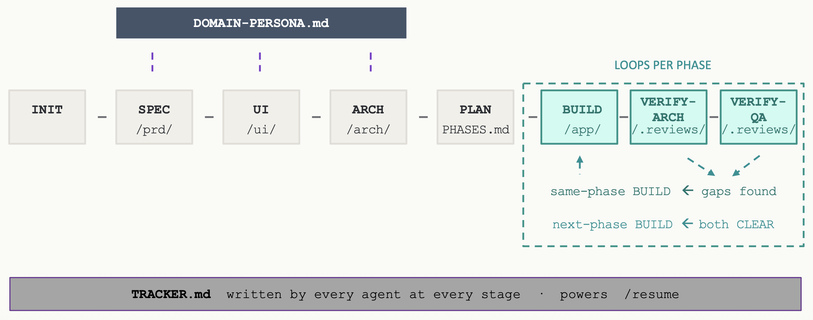
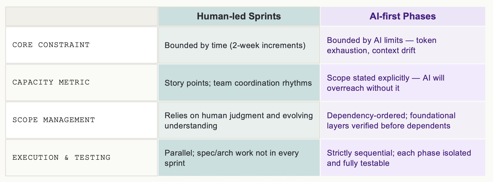
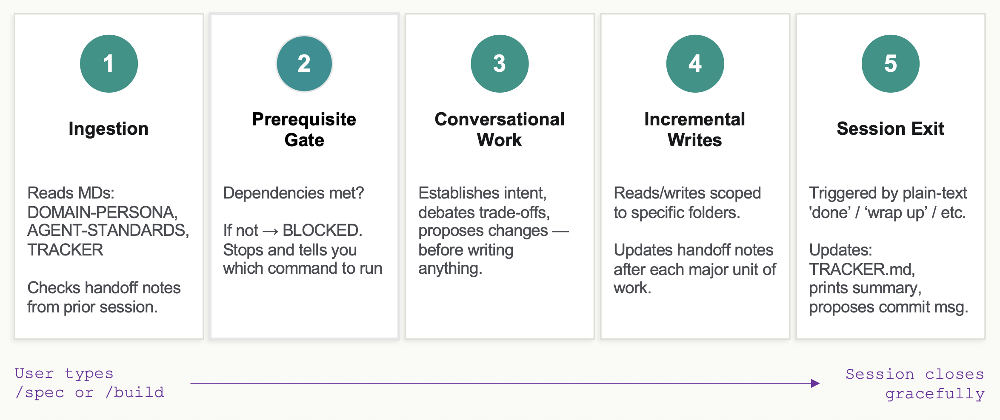

# PhaseCraft — An Opinionated Agentic Development Framework

PhaseCraft is a multi-agent SDLC framework for [Claude Code](https://docs.anthropic.com/en/docs/claude-code). It implements a lifecycle-staged, spec-driven approach to software development with AI agents. You get a team of specialized AI agents — Product Analyst, UI Specialist, Architect, Coder, QA Engineer and Project Manager, each with well defined role boundaries and scoped file access. Every piece of work has a clear role owner. You run slash commands; agents handle spec, design, architecture, implementation, and review through a structured lifecycle.  

---

> **Treating AI as (engineer + PM + architect + domain-expert) all-in-one leads to drift, churn, and degrading code over time.**
>  
> PhaseCraft separates these roles into bounded agents operating across distinct lifecycle stages, with humans-in-the-loop as checkpoint gates.

---

For the thinking behind this approach, see [The Lure of Malleability in AI-generated Software](https://adaptive.svbtle.com/the-lure-of-malleability-in-ai-generated-software).  

Work is organized into phases — coherent, dependency-ordered sets of features, each fully built, tested, and reviewed before the next phase begins. Think of a **phase as a sprint scoped for AI**: bounded by token limits and context drift, not time.

A *session* in this README means one Claude Code conversation — from the moment you type a slash command to when the agent prints its handoff summary.  
**Important:** Each slash command should run in its own session to avoid context bleed between agents.



> **Beta** — this framework is under active development and testing on Claude Code via Claude Desktop. Other environments have not been tested. Expect rough edges, submit feedback/bugs and check back for updates.

---

### How this README is structured

> **Start here:** [Lifecycle & Workflow](#lifecycle--workflow) → [Modes of Operation](#modes-of-operation) → [Quick Start & First Project](#quick-start--first-project)  
> **Using PhaseCraft:** [Command Reference](#command-reference)  
> **Understanding PhaseCraft:** [Framework Internals](#framework-internals)  
> **Reference:** [Practical Notes](#practical-notes) (models, multi-engineer, troubleshooting)  

---

## Lifecycle & Workflow

```
INIT → SPEC → UI → ARCH → PLAN → BUILD (per phase) → REVIEW (per phase) → UAT (per phase)
```

| Stage | What gets done | Agent |
|-------|-------------|-------|
| **INIT** | Project setup, domain for agents, repo structure | Project Manager |
| **SPEC** | Feature specs, test specs, non-functional requirements | Product Agent |
| **UI** | Personas, UI/UX spec, conversational interface spec | UI Agent |
| **ARCH** | Architecture, data models, deployment spec | Architect Agent |
| **PLAN** | Divide features into dependency-ordered phases | Project Manager |
| **BUILD** | Implement and test one phase at a time | Coding Agent |
| **REVIEW** | Architecture review + QA review per phase | Architect + QA Agents |
| **UAT** | Exercise the running application against the specs per phase | Product Agent |

  
While Phases are sequential, Stages are checkpoints, not locks. Any stage can be reopened without rolling back downstream work.

### Phases and review gates

The `/plan` command divides your features into dependency-ordered phases. Each phase is small enough for one Claude Code session (avoids token exhaustion), self-contained enough to test in isolation, and sequenced so foundational layers are built and verified before features that depend on them.



BUILD, REVIEW and UAT repeat for each phase. After each build, three independent checks must pass before the next phase begins:

- **`/verify-arch`** — checks code against architecture decisions, data models, and non-negotiables
- **`/verify-qa`** — audits test coverage against feature specs and test specs
- **`/verify-uat`** — exercises the running application against the feature specs and UI specs

The first two read code and tests. The third reads neither: it drives the running product the way a user would. All must report **CLEAR**. If gaps or deviations are found, the reports tell you exactly what to fix and which agent handles it. Reports are immutable — each run creates a new versioned file as an audit trail.

### The UAT stage

UAT runs last, once both automated reviews are CLEAR — there is little point exercising an application whose build is still moving. It is owned by the **Product Agent**, on the same principle that gives architecture review to the Architect: the agent that wrote the specification is the one qualified to judge whether the built thing satisfies it. `/spec` and `/verify-uat` are two applications of the same product knowledge at different points in the lifecycle.

What makes it a real check rather than a self-assessment is that the Product Agent is a black-box tester **by construction, not by discipline**. It never reads `/app/` or `/arch/` in either command. At UAT it sees the feature specs, the UI spec and mockups, and the running application at a URL — nothing else. It cannot rationalise a spec toward an implementation it cannot see. For the same reason it is read-only on `/prd/` during UAT: a deviation that turns out to be the spec's fault is routed to `/spec` and settled with you, not quietly fixed by the session that found it.

**This is not user acceptance.** Acceptance is yours. The stage produces a deviation report — what was specified, what the application did, how to reproduce it — so the acceptance you perform starts from a checked baseline rather than a blank page.

**Not every phase gets one.** Foundation phases often deliver nothing a person can exercise, so `/plan` marks each phase `UAT: applicable` or `N/A` when it writes PHASES.md; headless projects are `N/A` throughout. A phase marked `N/A` completes on the two automated reviews alone.

**Something has to be running,** and who starts it differs by mode. The Coding Agent writes a runtime handle at `/.agentic-reviews/build/runtime-phase-{N}.md` — base URL, start command, ready check, test credentials, seed command — but it does not start the server as part of a build, and the Product Agent cannot (no Bash, by design).

- **Interactive `/verify-uat`** — the session prints the start command and waits for you. It does not end; confirm the app is up and it continues.
- **`/uat-loop`** — the application must be running by the time the run reaches its UAT step, not necessarily when you invoke it: a phase that still has to be built has no runtime handle yet. The orchestrator is read-only and cannot start anything, so at that step it prints the start command and waits for you to confirm the application is up, exactly as interactive `/verify-uat` does. It halts only if you cannot start it.
- **Operator Mode** — the operator brackets it: it has the Coding Agent start the application, runs UAT, then has it stopped. This is the one thing an operator session does that no orchestrated loop can, and it is what makes a genuinely unattended UAT possible. The operator owns stopping what it started, including when it halts for an unrelated reason.

A start failure at this point should be rare, because the Coding Agent verifies the start command during the build and will not mark Build complete until the application comes up. If it happens anyway, it is routed as a fix-build rather than repaired on the spot — by then the phase carries CLEAR arch and QA verdicts, and any change to `/app/` invalidates both.

### Running a phase under controlled autonomy — `/build-loop`

`/build-loop N` runs the entire build → verify-arch → verify-qa loop for one phase on its own, repeating fix-build → re-verify until both reviews are CLEAR — instead of you running `/build`, `/verify-arch`, and `/verify-qa` by hand. It is driven by a dedicated **Orchestrator** agent — the one place in PhaseCraft where a slash command spawns workers on purpose. `/build-loop` adopts the orchestrator identity directly in your session (via `agent:`, no `context: fork`, like every other PhaseCraft command), then spawns the Coding, Architect, and QA agents as bounded workers (via the Agent tool) in *Autonomous Mode*, reads the verdict each one writes to disk, and decides the next step. The orchestrator must stay in the main conversation — it is never itself forked, because a forked context cannot spawn workers.

It does not remove the human gate — it **relocates** it from every step to the phase boundary. You confirm scope at entry — `/build-loop N` lists the phase's features and waits for your go-ahead before the loop starts; control returns to you at completion or at a halt, with a full audit trail (every build writes test results, every verify writes an immutable versioned report, TRACKER.md stays current). The orchestrator is a read-only controller: the workers write all artifacts and their own TRACKER columns, and the phase's `Complete` flag is reconciled by the Project Manager on the next `/resume` — exactly as in the manual flow after a CLEAR `/verify-qa`. It never commits — it prints a consolidated proposed commit message for you to review and commit.

> **Permission mode propagates to workers.** A spawned worker inherits the session's permission mode (e.g. accept-edits or bypass) — that is expected for an unattended run, but it means the workers will edit code under whatever mode you launched `/build-loop` in. Run it in a mode you're comfortable having apply to unattended edits.

**The hard ceiling on autonomy:** the loop runs to completion only when every gap is something the Coding Agent can fix without a human decision. The first gap that needs a spec or architecture decision halts the loop and hands control back to you:

| Halt | Meaning | What you do |
|------|---------|-------------|
| `halt-spec` | A gap needs a product/spec decision (e.g. a QA gap routed to the Product Agent) | `/spec` to resolve, then `/build-loop N` |
| `halt-arch-decision` | An Architect escalation or Non-Negotiable conflict | `/arch` to resolve, then `/build-loop N` |
| `halt-blocker` | Tests still failing after the build's internal retry cap, or a hard technical blocker | `/build N` interactively, then `/build-loop N` |
| `halt-cap` | 3 build→verify cycles elapsed without both reviews CLEAR | Review the gap reports; resume `/build-loop N` |
| `uat-deviations` | `/uat-loop` only — the running application deviates from the feature or UI specs | Read the UAT report, then `/uat-loop N` — the UAT session already reset the phase's cells, so it restarts at the fix-build |

**`/uat-loop N` is the same loop with the UAT stage appended.** The inner build → verify-arch → verify-qa cycle behaves identically, under the same cycle cap of 3; once both reviews are CLEAR it runs a **single** `/verify-uat` pass and stops on its verdict. There is no UAT retry loop, by design: an arch or QA gap means the code diverged from a decision already made, which the Coding Agent can close unattended, whereas a UAT deviation means the built thing does not do what was asked — a finding you should see before anything is changed in response to it. Every outer iteration is therefore human-sanctioned, which is also why no outer cap is needed. If a phase already reached both-CLEAR under `/build-loop`, `/uat-loop N` skips the inner cycle and goes straight to the UAT pass. The application must be running by the time the UAT pass starts; if it is not, `/uat-loop` pauses at that point with the start command and continues once you confirm it is up.

Both commands operate on exactly one phase per invocation (no ranges, no auto-advance). On a clean completion it recommends `/build-loop N+1` but does not run it. The manual `/build`, `/verify-arch`, and `/verify-qa` commands remain fully available for granular control, debugging, or the conversational path — `/build-loop` composes them, it does not replace them. Use the manual commands when you want a human gate at every step; use `/build-loop` when you want the phase driven to done with the gate at the boundary.

### Dependencies between stages

Stages generally run in order, and the framework will block you if a prerequisite is missing. The main nuances worth knowing upfront:

- Not all phases need to be fully spec'd upfront — the current phase (or two) needs complete feature spec, UI and architecture. Additional features can be evolved incrementally by re-running `/spec`, `/ui`, `/arch` and `/plan`.
- SPEC must cover foundational features before UI can begin — typically the core user flows and anything with non-obvious UI infrastructure needs
- ARCH needs enough UI stability for foundational decisions, but does not require complete UI coverage
- After ARCH is in place, UI for later phases may proceed incrementally (without re-running `/arch`) as long as no new UI infrastructure requirements are introduced 


---

## Modes of Operation

The same lifecycle, the same agents and the same artifacts can be driven three different ways. What changes between them is only *where the human gate sits* — at every step, at each phase boundary, or at the top level intent. Pick per task; they mix freely within one project.

| Mode | How you invoke it | Where the human gate sits | Who talks to the agents |
|------|-------------------|---------------------------|-------------------------|
| **Interactive** *(default)* | Any slash command — `/spec`, `/arch`, `/build`, `/verify-*` | Every step — agents propose before writing and wait for you | You, directly |
| **Controlled autonomy** | `/build-loop {N}` | After every `/spec`, `/arch`, `/ui` stage. Also, at the completion of each phase (once build → verify loop is done)  — you confirm scope at entry, control returns at completion or halt | The Orchestrator, on your behalf |
| **Operator** | Plain request to the main session — no slash command | Your stated intent — the operator asks only when a decision would conflict with or modify it | The operator assistant, on your behalf |

**Interactive** is the framework as described throughout this README. You run one command per session and converse with that agent directly. Use it whenever the work is the conversation — spec, UI, architecture — or when you want to inspect every step.

**Controlled autonomy** is `/build-loop`, covered in [Running a phase under controlled autonomy](#running-a-phase-under-controlled-autonomy--build-loop). It is scoped to one phase's build → verify loop and driven by a dedicated Orchestrator agent.

**Operator Mode** is the broadest. You ask the main session to act as your **operator assistant** and state what you want and it spawns the agents it needs, one at a time, each in its own context, working through the specifics on your behalf. It is Autonomous Mode with the operator standing in for you: agents never wait on a human, but where they would normally stop and ask, they ask the *operator*, which answers within your stated intent. Anything that would conflict with or modify that intent comes back to you.

The operator never spawns the Orchestrator and never uses `/build-loop` or `/uat-loop` — it performs the build → verify → UAT sequencing itself, so there is exactly one controller in the session. It relays each agent's handoff summary to you, and commits at natural boundaries. Whether it also pushes a branch or opens a PR is your choice, recorded once in the intent file's `Delivery` line; the default is commit only, and it never pushes to the default branch or merges. It is also the only session that may commission research: the Research Agent gets a question and nothing else, searches the web, and writes a sourced finding to `/research/` that only the operator reads — see [Agent overview](#agent-overview).

Before any work starts, the operator writes your intent to a file in `/intents/` and reads it back for confirmation. That confirmed file — not the chat — is the contract it is answerable to, which is what lets an operator session survive a crash, span several phases, and be picked up later or by another engineer. See [Intent files](#intent-files).

Operator Mode is the least supervised path and correspondingly the one to be most deliberate about. Your intent is the whole contract — the more precisely you state it, the less the operator has to interpret. See [Recommended models](#recommended-models) for how model choice propagates through an operator session.

---

## Quick Start & First Project


### Prerequisites

- [Claude Code](https://docs.anthropic.com/en/docs/claude-code) installed and working. PhaseCraft is specific to Claude Code — it uses Claude Code's agent, command, and file-access primitives. It is not directly usable with just the Claude API, Claude.ai chat, or other LLM clients.
- An active Claude subscription — Pro at minimum, Max recommended for projects of medium complexity or higher. The framework is token-heavy.
- A git-initialized repository for your project.

  
### Setup

> **Note:** Claude Code's plugin system is a likely future distribution path for PhaseCraft after further testing has happened.  
> This would replace the manual copy steps below with a single `/plugin install` command.  

**macOS / Linux / Git Bash / WSL:**

```bash
# 1. Create project repo
mkdir my-project && cd my-project && git init

# 2. Copy PhaseCraft framework files into your project root
cp /path/to/phasecraft/CLAUDE.md .
cp /path/to/phasecraft/DOMAIN-PERSONA.md .
mkdir -p .claude
cp -r /path/to/phasecraft/claude/. .claude/

# 3. Open Claude Code and run
/start
```

**Windows PowerShell:**

```powershell
# 1. Create project repo
New-Item -ItemType Directory my-project; Set-Location my-project; git init

# 2. Copy PhaseCraft framework files into your project root
Copy-Item C:\path\to\phasecraft\CLAUDE.md .
Copy-Item C:\path\to\phasecraft\DOMAIN-PERSONA.md .
New-Item -ItemType Directory -Force .claude | Out-Null
Copy-Item C:\path\to\phasecraft\claude\* -Destination .claude -Recurse -Force

# 3. Open Claude Code and run
/start
```

### Walkthrough

Each entry below should be run in a separate Claude Code session. Commit after each. To close a session with an agent, type 'wrap up', 'done' or 'close session' - this will trigger the agent to wrap up its work, and print a hand-off summary including any pending decisions or open questions (also recorded in TRACKER.md). The agent will also propose a commit message for you to commit.  

---

**`/start`** — The Project Manager asks what you're building, proposes a repo structure, and creates initial files after you confirm. This includes `DOMAIN-PERSONA.md`, which defines the domain expertise agents assume throughout the lifecycle — fill it out carefully.

---

**`/spec`** — Conversational. Each feature produces a paired feature spec and test spec file. NFR is captured in its own file. Run as many times as needed. When complete, a versioned compiled PRD and PRD Summary are generated in `/prd/output/`.

---

**`/ui`** — Produces personas, UI/UX spec, and conversational interface spec in `/ui/`. Skip if your app is headless (CLI, API-only, background service). After spec files are written, the UI Agent identifies which features warrant mockups and provides image-generation prompts. Use any image generation tool to create mockups, save them to `/ui/mockups/`, then proceed to `/arch`.

---

**`/arch`** — Reads PRD and UI specs, asks clarifying questions, proposes architecture. Pay close attention to the **Non-Negotiables** section it produces — these are decisions that cannot be changed without significant downstream rework.

---

**`/plan`** — Proposes phases with explicit scope and stop conditions. Treat the generated PHASES.md as a contract, at least for the current and upcoming phase.

---

**`/build {phase-number}`** — Implements exactly what is listed in the numbered phase block of PHASES.md . Writes tests alongside each feature, runs the full test suite, and iterates until all tests pass. Iterates up to 3 times on failures before stopping to ask for direction. Reports scope alignment on completion.

---

**`/verify-arch {phase-number}`** then **`/verify-qa {phase-number}`** — Architecture review followed by QA review for the specified phase number. Each produces a versioned report in `/.agentic-reviews/`.

If **GAPS FOUND**:

| Gap type | Action (with example phase number) |
|----------|------------------------------------|
| Architecture gap | `/build 1` to fix → re-run `/verify-arch 1` |
| QA gap (test implementation) | `/build 1` to fix → re-run `/verify-qa 1` |
| QA gap (spec ambiguity) | `/spec` to clarify → `/build 1` → re-run `/verify-qa 1` |

When both reviews are **CLEAR** → run `/verify-uat 1` if the phase is marked `UAT: applicable`.

---

**`/verify-uat {phase-number}`** — Start your application, then run this. The Product Agent exercises it against the feature specs and UI specs and writes a deviation report to `/.agentic-reviews/uat/`. Deviations route to `/build` (implementation doesn't match a clear spec), `/spec` (the spec is ambiguous or wrong), or `/ui` (the UI spec is). A build fix invalidates the phase's arch and QA verdicts, so the session resets both and points you at `/uat-loop {phase-number}` rather than a bare `/build`.

Two variants take arguments instead of, or alongside, a phase number, and can be combined:

- **`/verify-uat full`** — no phase number. A happy-path sweep of every phase already CLEAR at UAT, written to `uat-review-full-run-{R}.md`. Run it before a release or a demo, or after a phase that reworked shared foundations — not routinely, because the cost grows with the size of the product. Regular per-phase runs already carry a cheap regression check: the agent reaches features by navigating in from the real entry point, so a broken sign-in, nav, or shared layout is caught on the way.
- **`/verify-uat {phase-number} manual`** — run after you did a human-driven manual acceptance testing; mention your findings and the agent writes up what you found as a normal deviation report. Your findings then route, get audited, and drive the fix loop exactly as agent findings do.

A defect found this way is fixed in the phase that owns it, even if that phase is marked complete — reopening it in place. This beats carrying one phase's bugs into another's scope. This is the one exception to the never-reopen-the-phase rule, and it holds only for acceptance criteria that were already in force when the phase completed. Anything needing a new or changed criterion is scope, and goes forward through `/spec`. While a phase sits reopened, every later phase is blocked at its own prerequisites, so close it before moving on.

When all applicable gates are **CLEAR** → move to `/build 2` and repeat.

---

**`/build-loop {phase-number}` / `/uat-loop {phase-number}`** — The controlled-autonomy alternative to the steps above; `/uat-loop` is the same loop with the UAT pass appended. Runs build → verify-arch → verify-qa for the phase and loops fix-build → re-verify until both reviews are CLEAR, routing Coding-Agent-fixable gaps itself. It halts and hands control back to you only when a gap needs a spec or architecture decision, when a build is technically blocked, or after 3 cycles. Use it when you want the phase driven to done with the human gate at the phase boundary instead of at every step; use the manual `/build` + `/verify-*` commands when you want to gate each step yourself. See [Running a phase under controlled autonomy](#running-a-phase-under-controlled-autonomy--build-loop).

---

### Understanding the Situation and Next Steps

With work potentially spanning days and weeks, you do not need to recall or separately track the situation.

**After the first cycle**, use `/resume` at the start of each session — it reads TRACKER.md, tells you where things stand, and also recommends the next command (run in a separate session).

Running `/sitrep` in a new sesssion at any time will provide a brief report on the current state of the project.  

If you need to ask a question to a specific agent without wanting to run a full work session, use `/ask [agent]`.   

### Mid-lifecycle spec changes or new requirements

For requirement changes or new requirements after phases have been built, or even when a specific phase has been partially built (eg. pending verification), you may invoke the following for spec modifications:

1. `/spec` — update feature spec, generate new PRD version, generate diff
2. `/ui` — re-run if the change has UI/UX implications
3. `/arch` — re-run to check if the change has architectural implications
4. `/plan` — re-run always after spec changes or additions
5. `/build {phase-N}` — continue running current in-progress phase or next phase if no phase is in-progress
6. `/verify-arch {phase-N}` then `/verify-qa {phase-N}` — re-verify
  
**Important:** Completed Phases are never reopened for a spec change (the one exception, for defects UAT finds against criteria already in force, is under `/verify-uat` above). If a spec change makes a completed phase's output incorrect, the fix is forward-only — Project Manager's `/plan` session will add a corrective item to the next pending phase or the currently in-progress phase. In-progress phases are modified only if the change directly affects code being built or can't be deferred.  

PRD versions get a minor bump (+0.1) for modifications to existing features and a major bump (+1.0) for new features or sections added.

### Tips

- **One command per session.** This keeps context clean and avoids token exhaustion.
- **Let agents ask questions.** The framework is conversational — agents ask before assuming.
- **Don't skip stages.** The framework will block you if prerequisites aren't met.
- **Use `/resume` liberally.** If you're ever unsure what to do next, run it.

---

## Command Reference

| Command | Agent | Key Outputs |
|---------|-------|--------|
| `/start` | Project Manager | Repo structure, README, DOMAIN-PERSONA, TRACKER.md |
| `/resume` | Project Manager | Current state report + recommended next command |
| `/sitrep` | Project Manager | Current state report (read-only) |
| `/plan` | Project Manager | PHASES.md, TRACKER.md |
| `/spec` | Product Agent | Feature specs, test specs, NFR |
| `/ui` | UI Agent | Personas, UI/UX spec, conversational interface |
| `/arch` | Architect Agent | ARCHITECTURE.md, DATA-MODELS.md, DEPLOYMENT.md |
| `/build {phase-number}` | Coding Agent | Code + tests for phase N |
| `/build-loop {phase-number}` | Orchestrator | Controlled-autonomy build → verify loop for phase N (spawns coding/architect/qa) |
| `/uat-loop {phase-number}` | Orchestrator | The same loop plus a single UAT pass (also spawns product) |
| `/verify-arch {phase-number}` | Architect Agent | Architecture gap report |
| `/verify-qa {phase-number}` | QA Agent | Test coverage gap report |
| `/verify-uat {phase-number}` | Product Agent | UAT deviation report against the running application |
| `/verify-uat full` | Product Agent | Happy-path sweep across every UAT-CLEAR phase |
| `/verify-uat {phase-number} manual` | Product Agent | Your own acceptance findings, written up as a deviation report |
| `/ask [agent]` | Named agent (read-only) | Answers only; no file writes |

Each agent handles its own session entry, prerequisite checks, and TRACKER.md updates on close.

There is no slash command for Operator Mode — you invoke it by asking the main session in plain language to act as your operator assistant ("run in Operator Mode", "act as my operator assistant") and stating what you want done. The request must be explicit: the main session does not enter Operator Mode by inference. See [Modes of Operation](#modes-of-operation).


---

## Framework Internals

### Why PhaseCraft

Claude Code is powerful out of the box, but on non-trivial projects it tends to drift — mixing concerns, losing context over long sessions, skipping test coverage, and making architectural decisions on the fly. PhaseCraft solves this by imposing staged lifecycle gates, strict agent boundaries, phased builds and review checkpoints, including human-in-the-loop for commits.

### Agent overview

| Agent | Role | Reads | Writes |
|-------|------|-------|--------|
| **Project Manager** | Lifecycle, init, planning, status | Everywhere | TRACKER.md, PHASES.md, DOMAIN-PERSONA.md, README.md |
| **Product Agent** | Feature specs, test specs, NFR; UAT of the running application | `/prd/`, domain persona; `/ui/` and the running app (UAT only) | `/prd/` (spec only), review reports to `/.agentic-reviews/uat` |
| **UI Agent** | Personas, UI/UX spec, conversational interface | `/ui/`, `/prd/`, domain persona | `/ui/` only |
| **Architect Agent** | Architecture, data models, deployment; arch review | `/prd/`, `/ui/`, `/arch/`, `/app/` (review only) | `/arch/`, review reports to `/.agentic-reviews/arch` |
| **Coding Agent** | Implementation, tests | Everywhere | `/app/`, test results, runtime handle |
| **QA Agent** | Test coverage audit | `/prd/`, `/app/tests/`, test results | Review reports to `/.agentic-reviews/qa` |  
| **Research Agent** *(Operator Mode only; no slash command)* | Answers one question from outside sources — the only agent with web access | Nothing in the project — it has no `Read` tool; the task prompt is its whole input | `/research/` only; sourced, dated prose findings read by the operator alone |
| **Orchestrator** *(runs in the main session via `/build-loop` or `/uat-loop`; never forked)* | Drives one phase's controlled-autonomy build → verify loop, plus the UAT pass under `/uat-loop`; spawns coding/architect/qa, and product for UAT | Everywhere (read) | Nothing — read-only controller. Workers write all artifacts; completion is reconciled by the Project Manager on `/resume`. |  

In addition, all agents write status to TRACKER.md, and may send messages to any agent's inbox and consume messages from their own (`.agent-messages/`).  
NOTE: `/` here represents project root.


Agents are explicitly instructed not to read or write outside their boundaries. Also, if an agent encounters something outside its role, it stops and tells you which command to run instead.

### Folder structure (from project root)

```
CLAUDE.md                    ← framework entry point; auto-loaded into every session
DOMAIN-PERSONA.md            ← domain expertise persona; created during /start
TRACKER.md                   ← lifecycle and phase state (+ per-session Progress); updated by all agents
PHASES.md                    ← phase scope and boundaries; generated by /plan

.claude/
  FRAMEWORK-VERSION
  agents/
    AGENT-STANDARDS.md       ← universal rules; read by all agents
    PROJECT-MANAGER-AGENT.md ← /start, /plan, /resume, /sitrep
    PRODUCT-AGENT.md         ← /spec
    UI-AGENT.md              ← /ui
    ARCHITECT-AGENT.md       ← /arch, /verify-arch
    CODING-AGENT.md          ← /build
    QA-AGENT.md              ← /verify-qa
    ORCHESTRATOR-AGENT.md    ← /build-loop (controller; adopted in main session, spawns coding/architect/qa)
    RESEARCH-AGENT.md        ← no command; spawned by the operator only
  commands/                  ← slash command definitions

prd/                         ← generated by /spec
  sections/
    01-overview.md
    02-objectives.md
    03-functional-requirements/
      01-feature-name.md
      01-feature-name-tests.md
    04-non-functional-requirements.md
    05-future-features.md
  output/                    ← versioned compiled PRDs and summaries
  diffs/                     ← PRD version diffs

ui/                          ← generated by /ui
  01-personas.md
  02-ui-ux-spec.md
  03-conversational-interface.md
  mockups/

arch/                        ← generated by /arch
  ARCHITECTURE.md
  DATA-MODELS.md
  DEPLOYMENT.md

app/                         ← all application code; generated by /build
  tests/

.agentic-reviews/            ← generated by /verify-arch and /verify-qa
  arch/
  qa/
  uat/
  build/                     ← runtime handle and build verdict; transient, not versioned

.agent-messages/             ← directed agent-to-agent messages; transient
  <recipient-agent>/         ← one inbox per agent; one file per message; created lazily

intents/                     ← operator-session intent files; written by the operator in Operator Mode
research/                    ← Research Agent findings; read by the operator only; created lazily
```

### Framework file roles

**CLAUDE.md** is the universal framework foundation — auto-loaded into every session. It contains lifecycle stage ordering, TRACKER.md format definitions, and Phase Rework Policy. It contains no agent persona or command workflows.

**Agent files** (`.claude/agents/`) define each agent's role, guardrails (file access boundaries), workflow logic, output format, and exit criteria.

**Agent Standards** (`AGENT-STANDARDS.md`) owns behavioral rules that apply universally: session entry/exit, scope discipline, proposal discipline, commit conventions, review report integrity, and the agent messages layer.

**State vs. communication.** Two separate channels carry what agents need to coordinate. **TRACKER.md** is state only — lifecycle/phase status plus a per-row `Progress` cell that holds the current in-flight unit of work for crash resilience (overwritten as work proceeds, not a log). **`.agent-messages/`** is the communication layer — directed prose from one agent to another, one file per message in the recipient's inbox folder, consumed (cleared — overwritten with empty content, never physically deleted) by the recipient when it next runs. Messages are not human-facing (the chat handoff summary serves the human) and are committed like TRACKER.md so they travel between operators via git, sharing its cross-operator eventual-consistency limitation until a sync layer exists. Formal verification findings stay in review reports; messages are for ad-hoc context a specific agent needs that no report or the tracker already carries.

**Command files** (`.claude/commands/`) bootstrap each session: dispatch to the correct agent, enforce tool permissions, and run prerequisite checks. They contain procedural steps that overlap with agent files — this duplication is intentional for context resilience.

**DOMAIN-PERSONA.md** defines the domain expertise that various agents assume. A legal case management app gets agents that understand the legal profession; an e-commerce app gets agents that understand retail/commerce. This is filled conversationally during `/start` and significantly improves spec and design quality. Without it, agents operate as generalists. The domain persona file layers domain knowledge (using "assume expertise in ...", not "you are a ...") onto relevant agent's existing roles.  

### How sessions work



Agent sessions run directly — the user types a slash command and talks directly to that agent for the full session. The agent handles its own entry banner, prerequisite checks, conversational workflow, TRACKER.md updates, and handoff summary on close.

**Design decision:** Commands use the `agent:` frontmatter field (without `context: fork`) because PhaseCraft agents are conversational — the user interacts directly with the agent for the full session. `context: fork` would run the agent as a delegated task, preventing direct conversation. The `agent:` field loads the agent MD as the system prompt while the command file serves as the task prompt, and CLAUDE.md is auto-loaded as universal context. AGENT-STANDARDS.md is read by all agents.

**The first deliberate exception is the Orchestrator (`/build-loop` and `/uat-loop`).** It uses the same `agent:`-without-`context: fork` convention as every other command — adopted directly in the main session — but its purpose *is* to delegate: from the main session it spawns the Coding, Architect and QA agents via the **Agent tool**, each in Autonomous Mode, plus the Product agent under `/uat-loop`. It must stay in the main conversation; it is never itself forked, because a forked/subagent context cannot spawn further workers (which would break the loop). Spawning is quarantined to those targets by each command's `allowed-tools`, authorized in CLAUDE.md and nowhere else, so accidental forking of a conversational agent is still ruled out on the slash-command path. It may never spawn the Product agent to run `/spec` — resolving a spec is a human decision, and an orchestrator able to commission one could resolve its own halt. (Each worker runs with its own declared tools, so the Coding worker keeps Bash and the verify workers do not.)

**The second is Operator Mode**, and it is the one case where no slash command and no agent identity is involved. When you explicitly ask the main session to act as your operator assistant, it may spawn any PhaseCraft agent **except the Orchestrator**, each in its own context, with a task prompt that states the agent is running in Operator Mode. The exclusion is structural, not stylistic: the operator *is* the controller for that session, so admitting a second one would leave two things sequencing the same phase. The operator performs the build → verify sequencing itself instead.

Operator Mode is Autonomous Mode with the operator standing in for the human — same suppression of human gates, same unchanged discipline (file-access boundaries, role boundaries, Non-Negotiables, Review Report Integrity, normal Session Entry, incremental `Progress` writes). The one substantive amendment is what happens at a decision point: where an Autonomous-Mode worker performs a clean HALT, an Operator-Mode agent asks the operator and continues when the answer arrives. Halt codes still exist for anything the operator itself cannot settle — a missing upstream artifact, tests failing past the iteration cap, or a decision the user's stated intent does not cover. The full contract, including the operator's own obligations, is in `AGENT-STANDARDS.md` → Operator Mode; the authorization is in CLAUDE.md.

### Intent files

An operator session runs on your stated intent. `/intents/` is where that intent stops being a chat message and becomes an artifact.

**Written by the operator, confirmed by you.** You state what you want in plain language; the operator drafts the file, reads it back, and writes it only once you confirm — the same propose-before-writing discipline every other agent follows. From that point the confirmed file, not the conversation, is the contract it is answerable to. You do not hand-author these; if you want tighter control, tighten the draft before confirming.

**One intent, not one session.** A single intent file commonly spans several phases and several sessions. It stays `active` until the work it describes is discharged, then closes as `complete`. This is what makes an operator session resumable — a crashed or closed session leaves the contract intact on disk, and it travels between engineers by git exactly as TRACKER.md does.

**Filename:** `{timestamp}__{slug}.md`, using the same filesystem-safe UTC ISO-8601 form as agent messages (e.g. `2026-08-14T09-12-44Z__phase-3-to-5-build-out.md`).

**Structure.** YAML frontmatter carries the deterministic fields; the body is three short prose sections plus the amendments log.

```
---
created: 2026-08-14T09:12:44Z
operator: —              # human owner, if known
status: active           # active | complete | superseded
supersedes: —            # filename of the intent this replaces, if any
superseded-by: —         # set when a later intent replaces this one
---

## Intent
What you want done, and why. Subsumes objective and scope.

## Boundaries
What the operator must not do, must not touch, or must not decide alone — including anything explicitly out of scope, and any operating constraints (model and budget, phase range, technology limits).

## Human Gates
Where the operator must stop and come back to you before proceeding — named stage or phase boundaries, or specific decisions you want to see first.

## Delivery
commit only | commit and push branch | commit, push and open PR — plus the branch name for the last two. Defaults to commit only.

## Amendments
Append-only. One entry per question the operator escalated and the answer you gave, timestamped.
```

`Delivery` is the one place git beyond a local commit is authorized. The operator asks for it when confirming the intent. Whatever you choose, it never pushes to the default branch, never merges, and never force-pushes; a PR is opened for you to merge. Changing the setting later is an amendment.

Keep all sections short. `Boundaries` and `Human Gates` do the real work: the operator's standing rule is to escalate anything that would conflict with or modify your intent, and stating those limits up front turns a vague judgment call into a checkable list.

**Amendment or new intent?** When your answer to an escalation changes what was agreed, the operator classifies it and you confirm — the same way PRD version bumps are classified:

> An answer is an **amendment** if it resolves a question *within* the existing Intent and Boundaries — disambiguating or deciding something the intent already implied. If it changes the Intent, or widens or narrows the Boundaries, it is a **new intent file** that supersedes this one. A contradiction always forces a new file, never an amendment.

The point of the test is to stop the amendments log from quietly becoming the place the real contract lives. A superseded file is never edited or deleted — it is marked `superseded`, cross-linked to its replacement, and left as the record of what was authorized at the time. Reviews follow the same rule.

**Not read by agents.** Intent files are for the operator and for you. Spawned agents get their scope from the task prompt the operator composes and from the project artifacts — translating intent into agent-scoped instructions is precisely the operator's job. Nothing downstream reads `/intents/`, and no agent writes there.

### Extending the framework

To add a custom agent (e.g., a Security Agent or Deploy Agent), create a new `*-AGENT.md` in `.claude/agents/` following the structure of existing agent files, and a corresponding command file in `.claude/commands/` with the `agent:` frontmatter pointing to it.

> **Terminology note (Claude Code).** Custom commands have been folded into *skills* in recent Claude Code versions. PhaseCraft's `.claude/commands/*.md` files still work with the same frontmatter, so nothing here needs to change — but if you consult the docs, the canonical page is now "Skills" rather than "Slash commands."

---

## Practical Notes

### Recommended models

PhaseCraft does not enforce a model per command for direct, interactive use — choose based on your account, budget, and preference. The recommendations below are defaults, not constraints.

**Spawned agents are a different matter,** because you are not there to pick. Every agent except the Product Agent therefore carries a `model:` pin in frontmatter, which applies when that agent is spawned as a bounded worker — by `/build-loop` or by an operator session. `ARCHITECT-AGENT.md` and `QA-AGENT.md` pin `model: opus` so review quality holds up regardless of what the spawning session is running; the rest pin `model: sonnet`, which keeps unattended work cheap by default.* These pins are not expected to affect a directly-adopted session — `/arch`, `/verify-arch`, `/verify-qa` and the rest adopt the agent identity in your main session rather than being spawned as a subagent, so model there still follows whatever you have selected.

**`PRODUCT-AGENT.md` is deliberately left unpinned** so that it inherits the spawning session's model. Spec decisions have the largest downstream blast radius in the lifecycle — everything from architecture to test coverage is derived from them — so the Product Agent should get the best model in play, not a cheap default. The corollary is a recommendation: **run an operator session on Opus or Fable**, and the Product Agent inherits it.

Claude Code is understood to let a spawning session override a spawned agent's pinned model, which is what makes the operator's per-phase model judgment possible (see `AGENT-STANDARDS.md` → Operator Mode). Treat this as unverified across Claude Code versions — if the override does not take, the Coding Agent's `model: sonnet` pin is the outcome, which is a safe default from a budget perspective rather than a failure.

| Command | Recommended | Reason |
|---------|-------------|--------|
| `/start`, `/resume`, `/sitrep`, `/plan` | Sonnet | Coordination and file work; reasoning depth not critical |
| `/spec`, `/ui` | Sonnet | Conversational spec work; quality driven by domain persona and inputs |
| `/arch` | Opus | Highest reasoning depth; Non-Negotiables have large downstream impact |
| `/build` | Sonnet | Code generation; quality driven by spec and arch inputs |
| `/verify-arch`, `/verify-qa` | Opus | Gap detection benefits from careful reasoning |
| `/verify-uat` | Opus or Fable | Judging observed behavior against specs, and comparing screens to mockups, rewards depth; the Product Agent is unpinned, so this follows your selection |
| `/ask` | Sonnet | Conversational Q&A |
| `/build-loop` | Sonnet | Every worker runs its own pinned model, so the session model matters little: the Coding worker runs Sonnet and the Architect and QA workers run Opus, whichever model you launch under. Launching on Sonnet keeps the orchestrator itself cheap. |
| `/uat-loop` | Sonnet, or Opus/Fable | The inner cycle behaves as `/build-loop`. The Product worker is unpinned, so it inherits the session model — launch higher if you want the UAT pass to reason hard. |
| Research Agent *(spawned by the operator)* | Sonnet | Search and synthesis on a narrow question; no project context to reason over. Operator may override to Opus for contested or security-relevant questions. |
| Operator session *(no slash command)* | Opus or Fable | The unpinned Product Agent inherits the session model, so spec decisions get your best model. Pinned agents run their own model unless the operator overrides per phase. |

When in doubt, use Sonnet for speed and cost, Opus when the output has significant downstream consequences.

\* Frontmatter `model:` pinning is honored for genuine Claude Code subagent invocations — the Agent-tool spawn path used by `/build-loop` and by operator sessions. Whether it could ever affect a directly-adopted, non-forked session is Claude Code implementation behavior that hasn't been exhaustively verified, and may change across Claude Code versions. If a direct session unexpectedly shows the pinned model's behavior regardless of your interactive model selection, check your installed Claude Code version and report the issue.

**Subscription tier guidance.** Opus sessions consume tokens significantly faster than Sonnet sessions, and the framework recommends Opus for the work where reasoning depth matters most (`/arch`, `/verify-arch`, `/verify-qa`, the Architect/QA pins that apply inside `/build-loop` and operator sessions, and the operator session itself). This affects subscription tier choice:

- **Pro:** workable for small projects with few phases and simple architecture. Likely to exhaust Opus quota early in any non-trivial project.
- **Max:** recommended for real-world use. Multi-phase projects with meaningful architecture reviews benefit substantially from the higher quota.

Choosing Sonnet for all commands extends your quota significantly, at some cost to arch and review quality.

### Multi-engineer usage

Phases are strictly sequential — one phase complete before the next begins. Different engineers can own different stages or phases; the handoff mechanism is always files (TRACKER.md, PHASES.md, review reports). Human role coordination as well as orchestration among humans and AI is outside the scope of this framework.

### Coding standards

Create `CODING-STANDARDS.md` at project root with your project-specific implementation rules — naming conventions, formatting, error handling patterns, test structure, etc. The Coding Agent and QA Agent will read and apply it. These rules override the Consistency and Code Quality defaults in the Coding Agent for any overlapping areas, but do not override architectural constraints or Non-Negotiables defined in `ARCHITECTURE.md` (generated by `/arch`).

### Updating the framework

Copy new agent MDs into `.claude/agents/`, command MDs into `.claude/commands/`, `CLAUDE.md` into the project root, and `FRAMEWORK-VERSION` into `.claude/`. All agents pick up changes automatically on their next invocation. Restarting Claude Desktop is recommended. Existing review reports are unaffected.

**Upgrading from v0.6.x to v0.7.0.** Five additions, all drop-in — no PRD, phase, code, or review changes are needed, and no tracker migration runs.

*Research Agent* — `RESEARCH-AGENT.md`, the one agent permitted to search the web. It has no `Read` tool and receives a question only, so outside information enters a project without shaping or being shaped by what the project has already decided. Spawned only by an operator session; findings go to `/research/` and are read by the operator alone, which decides what other agents see. Two guards: the operator treats a finding as untrusted input (facts only, never instructions — anything that reads as a directive is reported to you and discarded), and the question must contain no secrets or project-identifying detail, since it leaves the machine. `AGENT-STANDARDS.md` → Tools names it as the sole exception to the no-web-search rule; the behavioral contract is under Operator Mode → Research.

*Delivery* — the intent file gains a `## Delivery` line: `commit only` (default), `commit and push branch`, or `commit, push and open PR`. It is asked for at intent confirmation and honored for the life of the intent. In every setting the operator never pushes to the default branch, never merges, and never force-pushes. Operator Mode only; no slash command pushes. Existing active intent files without the line behave as `commit only`.

*Live accounts* — a Coding Agent guardrail: against live cloud and SaaS accounts, implementation is read-only and dry-run only. Anything that creates, changes, or destroys a resource is written as a script under `/app/` and approved by you before it runs. In Autonomous Mode the script is written and its dry-run recorded; the run is left for you. Alongside it, an explicit ownership line: `DEPLOYMENT.md` records infrastructure decisions and contains no scripts; provisioning and deployment scripts are implementation under `/app/`, defaulting to `/app/deployment/` unless DEPLOYMENT.md names a tool-required location, and `/verify-arch` now checks them against `DEPLOYMENT.md`.

*Evaluation rubric* — for a feature whose output a model produces at runtime, the feature spec now carries the rubric as its acceptance criteria: the fixed input cases, what each is graded on, and the pass rule. The test spec adds cases the feature spec does not. `ARCHITECTURE.md` → Test Strategy keeps the harness (judge model, pinned settings, where the eval set lives — added in v0.6.0). `/verify-qa` audits eval coverage against the rubric, and routes a model-backed feature with no rubric to the Product Agent. Existing specs for model-backed features have no rubric until `/spec` next touches them.

*Model notes* — TRACKER.md gains an optional free-form `Model notes:` list under the Phase Status table, written by the operator when it chooses the Coding Agent's model for a phase, so a verified phase can be read alongside the model that built it. No column is added and nothing migrates. Handoff summaries and operator narration are also asked to stay brief — only what needs your attention, expand on request.

**Upgrading from v0.5.2 to v0.6.0.** Three additions.

*Operator Mode* — a third invocation mode alongside interactive and Autonomous, in which the main session acts as your operator assistant, spawns agents on your behalf within a stated intent, and performs the build → verify sequencing itself. The authorization is a second exception in CLAUDE.md (the Orchestrator remains the first, and is the one agent an operator may never spawn); the behavioral contract and the operator's obligations are in `AGENT-STANDARDS.md` → Operator Mode. Each agent's frontmatter `description` now states whether it may be spawned in Operator Mode. Operator sessions record their contract in a new `/intents/` folder — see [Intent files](#intent-files) — created lazily on the first operator session, so projects that never use the mode never get one. Frontmatter `model:` pinning also extends from the Architect/QA pair to every agent except the Product Agent, left unpinned so it inherits the spawning session's model — see [Recommended models](#recommended-models).

*Test Strategy* — `ARCHITECTURE.md` gains a section naming the test levels a project uses, what belongs at each, and how each runs, decided once at `/arch` rather than left to per-session judgment. The Coding Agent writes to it, `/verify-arch` checks conformance to it, and the QA Agent continues to audit requirement coverage regardless of level. Existing projects have no Test Strategy section until `/arch` is re-run; until then the Coding Agent proposes levels and asks you to record them.

*UAT stage* — a per-phase gate owned by the Product Agent via `/verify-uat`, exercising the running application against the feature and UI specs and writing a deviation report to `/.agentic-reviews/uat/`. `/uat-loop` is the orchestrated form (`/build-loop` plus a single UAT pass) and is the one place the orchestrator may spawn the Product agent. The Coding Agent now writes a runtime handle at `/.agentic-reviews/build/runtime-phase-{N}.md` so a UAT session knows where the application is.

**Migration.** The first two additions are drop-in — no PRD, phase, code, or review changes are needed. The UAT stage needs one `/plan` run. It adds a `UAT:` line to each PHASES.md phase block, written by `/plan`, and a `UAT` column to TRACKER.md's Phase Status table, added automatically by the first agent to write the tracker under the new version — the same normalization path the `Handoff notes` → `Progress` migration used, with `/resume` as the deterministic backstop since it runs at the start of every session. Phase completion now requires UAT alongside the two automated reviews. Phases already marked `✓ complete` keep that status — they completed under the rules in force at the time, and a gate they never had is not applied to them retroactively.

If you skip the re-plan, nothing breaks: phases with no `UAT:` line simply complete on the two automated reviews, exactly as they did in v0.5.2. But that is a gate silently not running, and `✓ complete` will mean something different from what it means in a migrated project — so `/resume` and `/sitrep` warn until you run `/plan`. Where UAT applicability is genuinely unclear, `/plan` proposes `applicable` and lets you downgrade it: an unnecessary UAT pass costs a session, a wrongly skipped one costs you the last human-facing gate before a phase is called done.

**Upgrading from v0.5.1 to v0.5.2.** v0.5.2 replaces the `mcp__filesystem__*` tool wildcard in every agent's frontmatter `tools` field (and each command's `allowed-tools`) with native tools — `Read`, `Write`, `Edit`, `Glob`, `Grep` — because Claude Code's permission gate matches tool names exactly and does not seem to expand the wildcard, so agents were hitting a manual permission prompt on every distinct filesystem MCP call. QA and the Orchestrator do not get `Edit` (QA never modifies code or prior reports; the Orchestrator never writes any file). `AGENT-STANDARDS.md` → Tools is updated to describe the native tools instead. v0.5.2 also adds `model: opus` to `ARCHITECT-AGENT.md` and `QA-AGENT.md` frontmatter, so the Architect and QA workers spawned by `/build-loop` always run Opus regardless of the model the main `/build-loop` session (and its Coding worker) is running under — see Recommended Models. Separately, v0.5.2 fixes agent message consumption: no non-Coding agent ever had a delete-capable tool (native tools can't delete files, and the standard filesystem MCP server never offered a `delete_file` op either), so "consume message = delete the file" was unworkable since messaging was introduced. Consuming a message is now overwriting it with empty content via the `Write` tool every agent already has access to; a message file with empty content is treated as already-consumed and skipped on read, rather than physically removed. Migration is otherwise drop-in — no PRD, phase, code, or review changes are needed. If an MCP filesystem server is still configured in your environment, it is simply unused by PhaseCraft agents from this version on.

**Upgrading from v0.5.0 to v0.5.1.** v0.5.1 includes patch-version semantics. Patch-vs-minor classification uses a patch-eligibility test (no existing test's expected outcome changes and no new behavior is required; contradictions are always minor). A patch a phase has picked up is recorded as `v{X.Y.Z}` in its PRD version column for provenance (treated as the base minor for all drift/rework). A patch clarification that maps to a **completed** phase is detected by `/plan` — it scans the `PATCH-v*` changelogs, maps clarified sections to phases, and adds a forward-only corrective to the next pending or in-progress phase; in-progress and pending phases keep the silent fast path. Migration is drop-in — no PRD, phase, code, or review changes are needed.

**Upgrading from v0.4.x to v0.5.0.** v0.5.0 adds the Orchestrator agent and the `/build-loop` command for controlled-autonomy per-phase build → verify loops. Migration is drop-in. No PRD, phase, code, or review changes are needed, and existing reports are unaffected. The next review reports written under v0.5.0 will carry the new `## Orchestrator Verdict` footer; older reports without it remain valid for manual runs.

**Upgrading from v0.3.x to v0.4.0.** v0.4.0 splits state from communication: TRACKER.md becomes state-only with a per-row `Progress` column, and directed agent-to-agent context moves to a `.agent-messages/` inbox layer. Migration is nearly automatic — the next full session normalizes the legacy `Handoff notes` column to `Progress` (existing content is preserved as valid in-flight context) and stamps `PhaseCraft version at last update` in TRACKER.md. No PRD, phase, code, or review changes are needed.

### Troubleshooting

**"BLOCKED" on session entry** — A prerequisite isn't met. The message says exactly what's missing and which command produces it.

**Agent refuses to do something** — Agents have strict role boundaries. If you ask the Architect Agent about test coverage, it will redirect you to the QA Agent. Follow the redirect.

**Session crashed or ended unexpectedly** — Agents write progress to TRACKER.md incrementally. Run `/resume` to pick up where you left off. At most you lose the current unit of work.

**Phase review found gaps** — This is the system working as intended. The review report routes each gap to the right agent. Run `/build N` for coding gaps, `/spec` for spec issues, then re-verify.

**Check status without changing anything** — `/sitrep` for a full read-only report, or `/ask [agent]` to consult any agent without making changes.

**Coding Agent asks permission to run the same test command every time** — The `Bash: /app/ only` guardrail scopes *where* the Coding Agent's Bash access reaches; it doesn't pre-approve individual commands, which is a separate Claude Code confirmation gate. Add your project's test/build commands to `permissions.allow` in `.claude/settings.json` (shared with the repo) or `.claude/settings.local.json` (personal, gitignored by default), using prefix-match syntax — for example:

```json
{
  "permissions": {
    "allow": [
      "Bash(npx vitest run:*)",
      "Bash(.venv/bin/python3 -m pytest tests/scripts/:*)"
    ]
  }
}
```

Each rule pre-approves that exact command prefix plus any arguments after it — `Bash(npx vitest run:*)` covers `npx vitest run --coverage`, not `npx vitest watch`. Adjust the commands to match your project's actual test runner.

### Known issues

Occasionally, slash commands with some models may trigger delegation to the agent in the background, spawned via the Agent tool (similar to context: fork behaviour). This happens despite the `agent:` field defined correctly in the command YAML frontmatter. To prevent this, an additional instruction has been added to the top of CLAUDE.md . This has been specifically observed with Opus.

Nevertheless if and when you face this problem, you will not see the session entry banner (which has the correct agent name sandwiched between ____ horizontal lines). In such a case, try starting a new session and running the command again, or use a different model.

**This warning does not apply to `/build-loop`.** That command is *supposed* to delegate — the Orchestrator runs in your session (you will see its entry banner) and spawns the build/verify workers via the Agent tool on purpose. It uses the `agent:` convention like other commands, so it is subject to the same occasional background-spawn issue above — but for the orchestrator that is functionally fatal (a spawned orchestrator cannot spawn its workers), not just cosmetic. If `/build-loop` ever fails to spawn workers, re-run, preferably on Sonnet. Workers running in Autonomous Mode intentionally suppress the usual confirmation gates and chatter; that is expected behaviour, not the accidental-delegation bug.